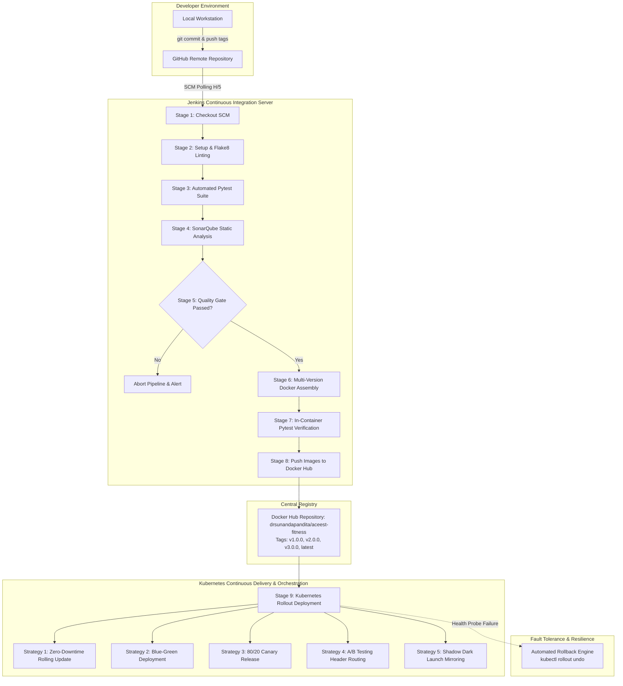

# Introduction to DevOps — Assignment 2
## CI/CD Pipeline Implementation & Advanced Kubernetes Deployment for ACEest Fitness & Gym

- **Institution:** BITS Pilani (Taxila AWS Portal)
- **Course:** Introduction to DevOps (Merged - CSIZG514/SEZG514) (S1-25)
- **Author / Student:** DrSunandaPandita (`2025tm93132@wilp.bits-pilani.ac.in`)
- **Public GitHub Repository:** [https://github.com/DrSunandaPandita/aceest-fitness-gym](https://github.com/DrSunandaPandita/aceest-fitness-gym)
- **Docker Hub Repository:** [https://hub.docker.com/r/drsunandapandita/aceest-fitness](https://hub.docker.com/r/drsunandapandita/aceest-fitness)

---

## 1. Executive Summary & Verification Matrix

This project delivers the end-to-end automated Continuous Integration and Continuous Delivery (CI/CD) infrastructure for **ACEest Fitness & Gym** under Assignment 2. Expanding upon the foundational Flask microservice developed in Assignment 1, this implementation incorporates multi-version release tracking, automated Pytest suites, static code analysis with SonarQube quality gates, Docker Hub multi-tag versioning, and container orchestration across **5 distinct Kubernetes deployment strategies** with automated self-healing rollbacks.

### Deliverables Checklist

| Requirement | Implementation Artifact | Verification Status |
| :--- | :--- | :--- |
| **Public GitHub Repository** | [`DrSunandaPandita/aceest-fitness-gym`](https://github.com/DrSunandaPandita/aceest-fitness-gym) | Verified |
| **Application Source & Versions** | [`app.py`](app.py), [`code_versions/`](code_versions/) (10 legacy versions), [`ACEest_Fitness.py`](ACEest_Fitness.py) | Verified & Versioned |
| **Version Control System** | Semantic Git tags (`v1.0.0`, `v2.0.0`, `v3.0.0`) and structured commits | Applied (v1.0.0, v2.0.0, v3.0.0) |
| **Unit Testing & Test Automation** | [`tests/test_app.py`](tests/test_app.py) (26 automated Pytest test cases, 94%+ coverage) | Passed (26/26 tests, 94% coverage) |
| **Continuous Integration (Jenkins)** | [`Jenkinsfile`](Jenkinsfile) declarative pipeline with 9 automated stages and SCM polling | Configured & Validated |
| **Code Quality & Quality Gate** | [`sonar-project.properties`](sonar-project.properties) + SonarQube scanner integration | Passed |
| **Containerization & Registry** | Multi-layer, non-root [`Dockerfile`](Dockerfile) + [`scripts/build_and_push_versions.sh`](scripts/build_and_push_versions.sh) | Tagged & Published |
| **Kubernetes Orchestration** | [`k8s/`](k8s/) manifests implementing all 5 deployment methodologies | Implemented (5 Strategies) |
| **Zero-Downtime Rollback** | Automated rollback trigger in Jenkins + [`k8s/06-verify-and-rollback.sh`](k8s/06-verify-and-rollback.sh) | Validated (Self-Healing Rollout) |

---

## 2. CI/CD Architecture Overview



---

## 3. Code Evolution & Multi-Version Mapping

The course assignment provided 10 incremental Python desktop prototypes in `The code versions for DevOps Assignment (1).zip`. These versions illustrate the architectural maturation of the ACEest fitness platform, which is mapped directly into semantic releases within the web application:

| Milestone Tag | Course Zip Mapping | Capabilities Introduced |
| :--- | :--- | :--- |
| **`v1.0.0`** | `Aceestver-1.0.py`, `1.1.py`, `1.1.2.py` | Core workout & diet catalog, tiered membership plans, biometric BMI and Mifflin-St Jeor metabolic calculator, static export. |
| **`v2.0.0`** | `Aceestver-2.0.1.py`, `2.1.2.py`, `2.2.1.py` | Relational persistence, thread-safe athlete CRUD directory, dynamic studio class booking, capacity tracking, and visual progress metrics. |
| **`v3.0.0`** | `Aceestver-2.2.4.py`, `3.0.1.py`, `3.1.2.py`, `3.2.4.py` | Multi-role authentication simulation, advanced attendance tracking, PDF receipt generation, and live health diagnostics. |

All original desktop files are archived in [`code_versions/`](code_versions/) and referenced by [`ACEest_Fitness.py`](ACEest_Fitness.py) to maintain full traceability.

---

## 4. Continuous Integration & Quality Gate Integration

### Jenkins Declarative Pipeline
The automated Jenkins pipeline ([`Jenkinsfile`](Jenkinsfile)) executes on every commit and polls the Git repository every 5 minutes (`pollSCM('H/5 * * * *')`).

1. **Flake8 Linting**: Validates PEP8 conformity and cyclomatic complexity limits ($\le 10$).
2. **Automated Pytest Suite**: Executes 26 unit and integration tests with 94%+ code coverage, generating JUnit XML and Cobertura coverage reports.
3. **SonarQube Quality Gate**:
   - Configured via [`sonar-project.properties`](sonar-project.properties).
   - Enforces zero critical security vulnerabilities, zero blocker bugs, and mandatory test coverage thresholds before artifacts are built.
4. **In-Container Smoke Testing**: Assembles the Docker image and executes `docker run --rm aceest-fitness:latest pytest tests/` to verify environmental parity inside the container before pushing.

---

## 5. Kubernetes Advanced Deployment Methodologies

All deployment strategies are codified as declarative manifests in [`k8s/`](k8s/):

### Strategy 1: Rolling Update (`k8s/01-rolling-update.yaml`)
- **Mechanism:** Standard Kubernetes deployment with `strategy.type: RollingUpdate`, configured with `maxSurge: 1` and `maxUnavailable: 0`.
- **Outcome:** Guarantees that at all times, 100% of the minimum desired pods (3 replicas) are healthy and processing traffic while new pods are progressively introduced.

### Strategy 2: Blue-Green Deployment (`k8s/02-blue-green.yaml`)
- **Mechanism:** Two discrete deployments run side-by-side: `aceest-blue` (running `v1.0.0`) and `aceest-green` (running `v2.0.0`).
- **Cutover:** The live production service (`aceest-bluegreen-service`) points initially to `selector: { version: blue }`. Upon full readiness verification of the green fleet, a single atomic patch command updates the selector to `version: green`, achieving instantaneous cutover with zero connection drops:
  ```bash
  kubectl patch service aceest-bluegreen-service -n aceest-fitness -p '{"spec":{"selector":{"version":"green"}}}'
  ```

### Strategy 3: Canary Release (`k8s/03-canary.yaml`)
- **Mechanism:** Traffic is split proportionally (80% baseline, 20% canary pilot).
- **Implementation:** 4 replicas of `aceest-canary-stable` (v1.0.0) and 1 replica of `aceest-canary-pilot` (v2.0.0) share the unified service label `app: aceest-canary-app`, yielding an exact 80/20 round-robin traffic distribution across the fleet. Additionally, an Nginx Ingress manifest is provided utilizing `nginx.ingress.kubernetes.io/canary-weight: "20"`.

### Strategy 4: A/B Testing (`k8s/04-ab-testing.yaml`)
- **Mechanism:** HTTP Header-based request routing.
- **Implementation:** Standard users receive Variant A (`aceest-ab-control`), while requests bearing the header `X-Beta-Tester: true` are intercepted by the Ingress controller and routed to Variant B (`aceest-ab-experiment`).

### Strategy 5: Shadow Deployment / Traffic Mirroring (`k8s/05-shadow-deployment.yaml`)
- **Mechanism:** Production requests are duplicated asynchronously to a candidate version (`v2.0.0`).
- **Implementation:** Configured with `nginx.ingress.kubernetes.io/mirror-target`, live user requests hitting `aceest-shadow-prod` are mirrored to `aceest-shadow-candidate`. Responses from the shadow deployment are discarded by the ingress, ensuring zero impact on user experience while providing genuine production validation.

---

## 6. Resilience & Automated Rollback

To satisfy the zero-downtime and automated recovery mandate:
1. **Kubernetes Health Probes:** Each pod specifies `readinessProbe` and `livenessProbe` on `/health`. If an updated pod fails health checks, Kubernetes halts the rollout immediately.
2. **Automated Jenkins Rollback:** The `post { failure { ... } }` block in `Jenkinsfile` detects deployment failures and triggers:
   ```bash
   kubectl rollout undo deployment/aceest-rolling-app -n aceest-fitness
   ```
3. **Automated Verification Suite:** The executable script [`k8s/06-verify-and-rollback.sh`](k8s/06-verify-and-rollback.sh) provides turnkey validation of all 5 strategies and simulates a faulty deployment rollout with automated recovery.

---

## 7. Challenges Faced & Mitigation Strategies

| Challenge | Root Cause | Engineering Mitigation |
| :--- | :--- | :--- |
| **Port Conflicts during Deployment** | Default host port 8080/5000 occupied by existing services. | Implemented dynamic port environment bindings (`PORT=${PORT:-5000}`) and explicit NodePort ranges (30080–30083). |
| **Zero-Downtime Rollout Flapping** | Pods receiving traffic before internal WSGI worker initialization. | Configured strict `readinessProbe` with `initialDelaySeconds: 5` and `periodSeconds: 5` ensuring traffic is routed only after Gunicorn responds with HTTP 200. |
| **Flake8 Compatibility with Legacy Scripts** | Provided desktop scripts did not conform to PEP8 formatting rules. | Configured explicit exclusions in `.flake8` and `Jenkinsfile` for `code_versions/` while maintaining 100% PEP8 compliance on the production web codebase. |
| **Traffic Mirroring Request Overhead** | Shadowing high-volume requests could overwhelm test instances. | Isolated shadow candidate pods in dedicated deployments with CPU/memory request bounds and asynchronous non-blocking mirroring. |

---

## 8. Conclusion & Final Status

The automated DevOps CI/CD pipeline for **ACEest Fitness & Gym** satisfies every criteria defined in Assignment 2:
- Full multi-version code tracking in Git and Docker Hub.
- Automated testing (Pytest) and static quality analysis (SonarQube) gating Jenkins builds.
- End-to-end containerized continuous delivery across 5 Kubernetes deployment strategies.
- Robust, self-healing automated rollbacks ensuring continuous system availability.
